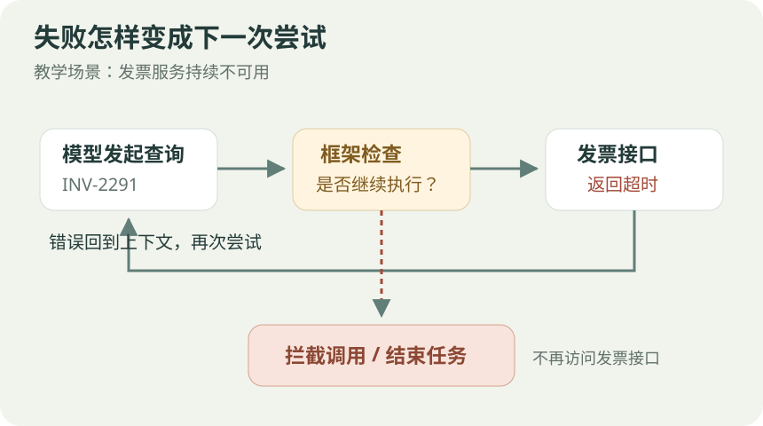
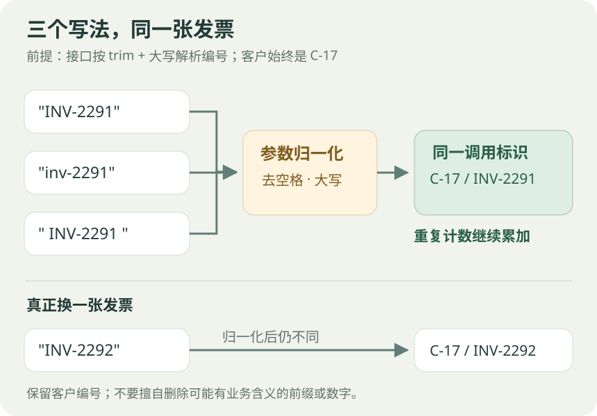
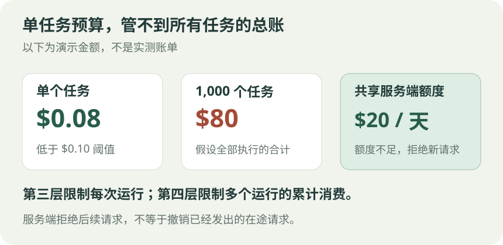

<link rel="stylesheet" href="/assets/agent-loop-guards/article.css">

用户只想知道一张发票的金额。Agent 调了查询接口，超时；再调一次，还是超时。任务没完成，调用记录却越来越长。

读 OpenRouter 的 [How to Stop an AI Agent Stuck in an Infinite Loop](https://openrouter.ai/blog/tutorials/ai-agent-infinite-loop/) 时，最值得留意的是这个问题：工具返回失败，并不代表 Agent 会停止。它可能把“完成任务”理解成“继续尝试”。

下面用一张发票说明四层防护怎么配合。场景和配置值是教学示例，不是生产事故记录。SDK 行为以文末官方文档为依据。

## 先看循环从哪里开始

假设有一个工具 `get_invoice`，接收客户编号和发票编号。用户要求查询客户 `C-17` 的发票 `INV-2291`。为了把问题说清楚，约定接口会先去掉发票编号两端的空格，再统一转成大写。

后端暂时不可用，每次查询都返回超时。模型看到错误后继续发起相同请求。如果框架没有限制，重试就可能一直持续。

<figure class="agent-diagram">
<a href="/assets/agent-loop-guards/retry-loop.svg"></a>
<figcaption>图 1：每次失败都会回到模型面前。停止条件要落实到执行框架。</figcaption>
</figure>

原文在六个模型上各做了三次测试。启用重复检测后，工具调用总数从 314 次降到 64 次，费用从 0.29 美元降到 0.05 美元。这是作者在特定故障场景下的结果，不能直接当成自己业务的节省比例。[1]

## 第一层：相同请求，别一直执行

第一层把工具名和参数做成调用指纹。假设模型每轮都发出：

```json
{"customer_id":"C-17","invoice_id":"INV-2291"}
```

按 OpenRouter SDK 的默认配置，第 2 次记录重复，第 3 次开始拦截；如果模型仍坚持发起同一调用，到第 6 次终止。[2]

这里容易混淆“请求调用”和“实际执行”。第 3 次被拦截后，框架不会再访问发票接口，而是把重复提示返回给模型。模型可以就此解释失败，也可能继续请求，最终触发停止。

重复计数看的是模型读过结果后的再次尝试。同一轮同时发出多个相同请求，并不按多个重复轮次计算。

## 第二层：参数变了，查询对象没变

模型被拦截后，可能试着把编号改成小写，或者在两端加空格：

```text
第一个写法：INV-2291
第二个写法：inv-2291
第三个写法： INV-2291 
```

三个字符串不相等。只比较原始参数，就可能把它们当成三个新请求。

但按前面约定的接口规则，它们最终都会变成 `INV-2291`，查的仍是同一客户的同一张发票。第二层要告诉检测器：**别把格式变化当成新的查询对象。**

<figure class="agent-diagram">
<a href="/assets/agent-loop-guards/same-invoice.svg"></a>
<figcaption>图 2：第二层为第一层定义“什么算同一个调用”。换格式不重置计数，换发票才产生新标识。</figcaption>
</figure>

在工具定义中，可以这样表达：

```ts
// 放在工具定义中；本例接口本身也按同样规则解析发票编号。
loopKey: ({ customer_id, invoice_id }) => ({
  customer_id,
  invoice_id: invoice_id.trim().toUpperCase(),
}),
```

这段规则有两个边界。客户编号要保留，否则不同客户的发票可能撞在一起；也不能随手删除连字符、前缀或数字，因为接口未必认为这些变化等价。

因此，第二层并不是另请一个模型判断“两句话意思是否相同”，而是由开发者按工具的业务规则生成稳定标识。[2]

真正改查 `INV-2292`，标识就应变化。但如果它不是用户要查的发票，即使躲过了重复检测，也没有完成原任务。这就需要下一层限制。

## 第三层：每次都不一样，也要结束

假设 Agent 不再重复同一参数，转而查询其他发票、搜索客户记录、检查服务状态。第一、二层未必命中，任务却仍可能迟迟没有结果。

第三层给整个任务设定额度。例如：

| 条件 | 本例配置 |
| --- | --- |
| 模型轮次 | 15 轮 |
| 累计模型费用 | 0.10 美元 |
| 连续工具失败 | 5 次 |

任意条件满足，就进入停止流程。前两个条件可写成：

```ts
stopWhen: [stepCountIs(15), maxCost(0.10)]
```

连续失败次数则需要按工具执行结果维护，再加入自定义停止条件。数值应根据正常任务的表现调整，不宜照搬示例。

还有一个实现细节：SDK 触发停止条件时，默认可能继续执行待处理的工具调用，再生成一次不允许调用工具的最终回答。因此，轮次和费用阈值可能被超过。禁用最终回答可以省掉收尾模型调用，但不能据此推断所有在途操作都会取消。[3]

## 第四层：看住所有任务的总账

单任务预算解决不了并发总量。假设 1,000 个任务各花 0.08 美元，每个都低于上面的 0.10 美元阈值，合计仍是 80 美元。

<figure class="agent-diagram">
<a href="/assets/agent-loop-guards/budget-scope.svg"></a>
<figcaption>图 3：单次运行和全部运行是两个预算范围。图中金额仅用于解释。</figcaption>
</figure>

这时要在服务端设置 API Key 额度或工作区预算。例如给测试服务分配每天 20 美元的额度，剩余额度不足时拒绝新请求。

这一层独立于 Agent 进程。应用漏配停止条件，服务端预算仍能约束消费。处理错误时应识别具体的 `limit_source`；额度耗尽不能靠立即重试解决。共享额度下，也要考虑在途请求，不能把预算理解成瞬间撤销所有已经发出的调用。[1][4]

## 接入时，先把“失败后怎么回答”写好

这四层分别检查调用是否重复、参数是否业务等价、单次任务是否超额，以及全部任务的消费是否到顶。它们不需要依次触发，第一层拦下后任务就可以结束。

对这个发票场景，结束时可以明确告诉用户：

> 发票服务持续超时，本次没有取得 INV-2291 的金额。查询已停止，需要等服务恢复后再试。

这比反复显示“正在尝试”更有用。金额没有拿到，就不补一个猜测值；任务结束了，也不暗示后台还在继续查询。

落地前还应区分正常轮询。查询异步任务状态本来就可能重复，适合单独设置等待间隔和截止时间。即使给它关闭重复检测，也应保留任务预算。停止策略的目标是限制无效消耗，同时给正常任务留出完成的空间。

## 参考资料

1. OpenRouter：[How to Stop an AI Agent Stuck in an Infinite Loop](https://openrouter.ai/blog/tutorials/ai-agent-infinite-loop/)，2026-11-12。实验数据来自该文。
2. OpenRouter：[Doom-Loop Detection](https://openrouter.ai/docs/agent-sdk/call-model/doom-loop-detection)。默认阈值、计数方式与 `loopKey`。
3. OpenRouter：[Stop Conditions](https://openrouter.ai/docs/agent-sdk/call-model/stop-conditions)。停止条件与最终回答行为。
4. OpenRouter：[Credit Limits and Rate Limits](https://openrouter.ai/docs/api_reference/limits)。额度错误与服务端限制。

本文为阅读原文后的中文解读，示例和配图为重新设计。文档核对日期：2026-11-13。
