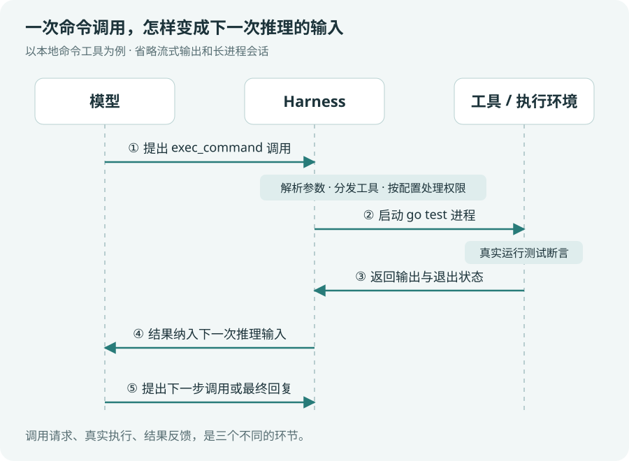
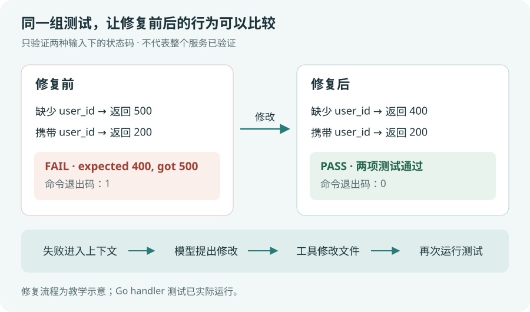

<link rel="stylesheet" href="/assets/codex-harness/article.css">


你在 Codex 里输入一句话：

> 修复 `/orders` 接口在缺少 `user_id` 时返回 500 的问题。缺少参数应该返回 400，补上测试，并说明修改内容。

随后，界面开始滚动：读取文件、修改代码、运行测试。过了一会儿，Codex 告诉你改好了。

这个过程很容易被概括成“大模型会写代码”。但如果仔细看，会冒出一个更具体的问题：**模型生成了 `go test ./...` 这段文字，机器上的测试为什么就真的跑起来了？**

从一段输出到一次真实执行，中间有一套程序负责接手。Codex Harness 就包含了这套执行和协调机制。

这一篇先跟着一次命令往下走。读完后，你应该能把“模型想做什么”“程序实际做了什么”和“结果说明了什么”分清楚。

## 先把模型和运行它的程序分开

只调用一次模型 API，你通常会得到一份响应。响应里可以有解释、有代码，也可以有工具调用请求。对于本文讨论的本地命令工具，模型不会因为输出了一条命令，就直接在你的电脑上创建进程。

必须有程序接收请求，找到对应工具，按配置处理权限，再把命令交给执行环境。执行结束后，还要收集结果，让模型有机会继续判断。

在这个系列里，我们把围绕模型、负责推进任务的这层运行程序称为 **Harness**。OpenAI 在介绍 Codex 时，也用这个词描述其核心 Agent Loop 和执行逻辑。[1]

拿修复接口的任务来说，几个角色的分工是这样的：

| 角色 | 在这个任务中做什么 |
| --- | --- |
| 用户 | 给出目标：缺少参数返回 400，并补测试 |
| 模型 | 根据当前信息判断下一步，提出读取、修改或测试的调用 |
| Harness | 组织上下文，接收调用，分发工具，处理执行状态，并衔接下一次推理 |
| 工具实现 | 具体读取文件、应用补丁或启动命令，整理执行结果 |
| 操作系统与进程 | 在给定的权限和环境里执行代码，产生输出或修改文件 |

工具实现通常就是 Harness 的组成部分或接入的能力。这里把它单列出来，是为了看清“协调执行”和“具体干活”的区别。实际工具也可能运行在远程服务或沙盒里。

<figure class="harness-diagram">
<a href="/assets/codex-harness/01-execution-loop.svg"></a>
<figcaption>图 1：模型根据输入提出行动；Harness 组织执行，并把执行结果送回后续推理。图中只展示本地命令这条路径。</figcaption>
</figure>

## 模型先提出一个结构化请求

假设 Codex 已经读过接口代码，也知道当前可以使用一个命令工具 `exec_command`。模型希望先运行测试，看看问题能不能复现。

它可以生成下面这样的调用项：

```json
{
  "type": "function_call",
  "name": "exec_command",
  "call_id": "call_test_01",
  "arguments": "{\"cmd\":\"go test -v -count=1 ./...\"}"
}
```

这是按照 Responses API 形式写的教学示例，省略了其他字段；具体工具名、命名空间和参数会随配置变化。它不是本次实验抓取的网络报文。

这里有三个值得停下来看的地方。[2][3]

`name` 表示模型要调用哪个工具。模型能提出这个请求，是因为这次推理可用的工具定义里有对应能力。工具名称、用途和参数约定要由系统提供。

`arguments` 是传给工具的参数。在这类 function call 中，它是一个装着 JSON 的字符串，工具侧还需要解析。这个例子只有一个参数 `cmd`，工作目录等信息由执行上下文提供。

`call_id` 用来把后面的工具结果和这次调用对应起来。如果连续运行两次测试，系统需要分清每份输出属于哪次请求。

**到这一步，测试还没有运行。** 系统得到的是“请调用这个工具，并传入这些参数”的请求。普通回复里贴着同一条命令，并不会自动触发工具执行。

## 谁把这份请求变成了一个进程

Harness 接到调用后，需要走完一段执行路径。

先根据工具名找到实现，再把参数交给对应处理器。处理器会解析参数，结合工作目录、环境变量等执行上下文组织命令。对于需要权限判断的动作，相关执行路径还要按配置处理审批与沙盒，决定能否继续。[4][5][6]

这些步骤不能简单理解成“先问用户同不同意”。有些操作可以直接执行，有些需要审批，也有些会被当前策略拒绝。具体行为取决于配置、平台和操作本身。

当执行条件满足，命令工具才会通过底层进程设施启动命令。对于我们的例子，Go 工具链会编译测试并运行它们。测试代码里调用了 HTTP handler，检查收到的状态码是不是 400。

这时发生的事情都在模型之外：编译器检查语法，测试进程执行断言，操作系统负责进程与文件访问。模型不会因为认为代码正确，就让失败的断言变成成功。

如果机器上根本没装 Go，或者工作目录选错了，执行会得到另一类失败。这样的结果只能说明测试没跑成，不能直接说明接口实现有问题。

## 让错误真正发生一次

为了把结果讲具体，本文附带一个只依赖 Go 标准库的小例子。它省略了数据库和真实订单查询，只保留参数缺失时的错误分支。

修复前，handler 中有这样的代码：

```go
userID := r.URL.Query().Get("user_id")
if userID == "" {
    http.Error(w, "lookup orders failed", http.StatusInternalServerError)
    return
}
```

测试用 `httptest` 构造一个没有 `user_id` 的请求，再检查状态码：

```go
func TestOrdersMissingUserID(t *testing.T) {
    req := httptest.NewRequest(http.MethodGet, "/orders", nil)
    rec := httptest.NewRecorder()
    Orders(rec, req)
    if rec.Code != http.StatusBadRequest {
        t.Fatalf("expected 400, got %d", rec.Code)
    }
}
```

运行 `go test -v -count=1 ./...` 后，失败信息里会出现：

```text
expected 400, got 500
```

这行信息来自测试进程，说明我们给定的请求经过当前 handler 后，确实得到了 500。

接下来，命令工具收集输出与退出状态，Harness 把结果关联到此前的调用。按通用 function calling 的形式，可以把它示意成：

```json
{
  "type": "function_call_output",
  "call_id": "call_test_01",
  "output": "exit_code=1\nTestOrdersMissingUserID: expected 400, got 500"
}
```

`output` 的文本布局是本文简化的，实际 Codex 工具可能还会提供耗时、截断信息或进程会话信息。这里要看的是 `call_id`：它把这份失败结果连回了那次运行测试的请求。[2][3]

Harness 随后把调用及结果纳入后续推理的输入。此时，模型拿到的新信息就很具体了：刚才运行了哪个测试，测试期待什么，实际发生了什么。

## 模型看到结果，再决定下一步

看到“期待 400，实际 500”，模型可以结合此前读到的代码，提出修改错误分支的调用。在本例中，修复后的分支是：

```go
if userID == "" {
    http.Error(w, "user_id is required", http.StatusBadRequest)
    return
}
```

这段修改仍然需要通过工具落实到文件。模型生成补丁，补丁工具才实际修改代码；模型再次提出运行测试，命令工具才再次执行测试。

<figure class="harness-diagram">
<a href="/assets/codex-harness/02-test-feedback.svg"></a>
<figcaption>图 2：修复路径是教学示意。图中的测试行为由附带 Go 示例验证，模型调用顺序不是一次完整 Codex 会话的实录。</figcaption>
</figure>

附带示例分别保留了修复前和修复后的代码，测试内容相同：一项检查缺少参数时返回 400，另一项检查带有 `user_id=42` 时返回 200。两组代码在本地分别运行，结果如下：

| 检查项 | 修复前 | 修复后 |
| --- | --- | --- |
| 缺少 `user_id`，期待 400 | 失败：实际返回 500 | 通过 |
| 带有 `user_id=42`，期待 200 | 通过 | 通过 |
| 测试命令退出码 | 1 | 0 |

这里做的是一次真实的 Go 测试复现，没有运行完整的 Codex 自动修复实验。测试环境、命令和原始输出记录在配套材料中。

结果为修改提供了证据，但证据有范围：这两个测试覆盖的是两种输入下的状态码。它们没有验证鉴权、订单查询、并发行为，也没有证明整个服务不存在其他缺陷。

因此，合理的最终回复应该说明改了什么、跑了哪些测试、有哪些尚未验证的部分。模型生成一句“已经修好了”，本身不能替代这些检查。

## Harness 里最基本的循环

到这里，就能把上面的过程缩成一小段伪代码：

```python
history = initial_context(user_request)

while within_budget() and not cancelled():
    response = model.generate(history, tools=available_tools)
    history.extend(response.items)

    if response.requests_tools():
        for call in response.tool_calls:
            result = dispatch_with_policy(call)
            history.append(tool_result(call.id, result))
        continue

    if response.ends_turn():
        return response.final_message

return stopped_status()
```

这段代码是解释控制流用的伪代码，不是 Codex 源码，也不能直接当成 SDK 示例运行。`dispatch_with_policy` 代表分发和策略处理；拒绝执行、参数错误等情况也需要形成可处理的结果。流式响应、并行调用、异常恢复和上下文压缩都被省略了。预算检查是教学版加入的停止条件，不表示 Codex 恰好使用这个函数或配置。

读这段伪代码时，可以注意谁在决定什么。

模型根据目前的信息提出下一步；Harness 负责让这些步骤能够执行、被拒绝或停止，并保存继续推理需要的信息。下一次模型调用拿到不同的输入，因此可能作出不同的判断。这就是工具反馈能够改变后续行为的原因。

循环也不会因为“打印了一段文字”就必然结束。工作中的进度说明和面向用户的最终回复，需要由协议与状态来区分。用户取消、执行失败或达到限制，也可能让任务提前停止。

这一篇先记住一个区别就够了：**一次模型响应结束，不等于整个用户任务结束。** 用户只说了一句话，系统仍然可以在后台经历多次推理和工具执行。[1]

## 在 Codex 源码里，从哪里开始看

概念理解之后，再看源码会容易很多。本文核对的公开仓库版本是 `openai/codex` 的提交 `69231e119bfca0b14453515e97d99688ce1c47c9`。下面的链接都固定到这个版本，避免后续重构让路径与文章对不上。

| 阅读入口 | 对应的问题 |
| --- | --- |
| [protocol/src/models.rs](https://github.com/openai/codex/blob/69231e119bfca0b14453515e97d99688ce1c47c9/codex-rs/protocol/src/models.rs) | `FunctionCall` 和 `FunctionCallOutput` 如何表达调用及结果 |
| [core/src/tools/router.rs](https://github.com/openai/codex/blob/69231e119bfca0b14453515e97d99688ce1c47c9/codex-rs/core/src/tools/router.rs) | `build_tool_call` 如何把响应项转换成内部工具调用 |
| [core/src/tools/registry.rs](https://github.com/openai/codex/blob/69231e119bfca0b14453515e97d99688ce1c47c9/codex-rs/core/src/tools/registry.rs) | `dispatch_any_with_state` 如何进入已注册工具的执行路径 |
| [unified_exec/exec_command.rs](https://github.com/openai/codex/blob/69231e119bfca0b14453515e97d99688ce1c47c9/codex-rs/core/src/tools/handlers/unified_exec/exec_command.rs) | `ExecCommandHandler` 如何处理命令调用并交给执行管理器 |
| [core/src/tools/orchestrator.rs](https://github.com/openai/codex/blob/69231e119bfca0b14453515e97d99688ce1c47c9/codex-rs/core/src/tools/orchestrator.rs) | 执行路径如何协调审批、沙盒选择和相关重试 |

这些文件是阅读入口，表格顺序并不表示所有工具都会经过同一条固定调用栈。首篇只核对职责与数据结构，完整执行链放到工具调用专题里展开。

回到开头那条 `go test ./...`：模型提出调用，Harness 把它接入真实执行，测试进程产生结果，结果再成为模型下一次判断的依据。少了其中任何一段，“帮我修复接口”都可能只停留在一份看起来正确的答案上。

下一篇《一个任务，为什么要调用模型几十次？》，继续拆开这层循环：一轮任务里究竟有哪些状态，又是什么让它继续或结束。

## 资料与配套示例

[下载本文 Markdown、SVG 配图和 Go 示例](/assets/codex-harness/codex-harness-01-source.zip)。压缩包内附修复前后代码和原始测试记录。

- [1] OpenAI：[Unrolling the Codex agent loop](https://openai.com/index/unrolling-the-codex-agent-loop/)。用于核对 Harness 与 Agent Loop 的概念。
- [2] OpenAI：[Function calling](https://developers.openai.com/api/docs/guides/function-calling)。用于核对调用、参数与结果关联的基本协议。
- [3] `protocol/src/models.rs`，固定版本链接见上表。
- [4] `tools/router.rs` 与 `tools/registry.rs`，固定版本链接见上表。
- [5] `tools/handlers/unified_exec/exec_command.rs`，固定版本链接见上表。
- [6] `tools/orchestrator.rs`，固定版本链接见上表。
- 示例目录：`demo/before/` 和 `demo/after/`。分别进入目录后执行 `go test -v -count=1 ./...`。前者预期失败，后者预期通过。

资料核对日期：2026-11-13。协议报文、执行图和伪代码均为教学表达；Go 测试结果以配套执行记录为准。
